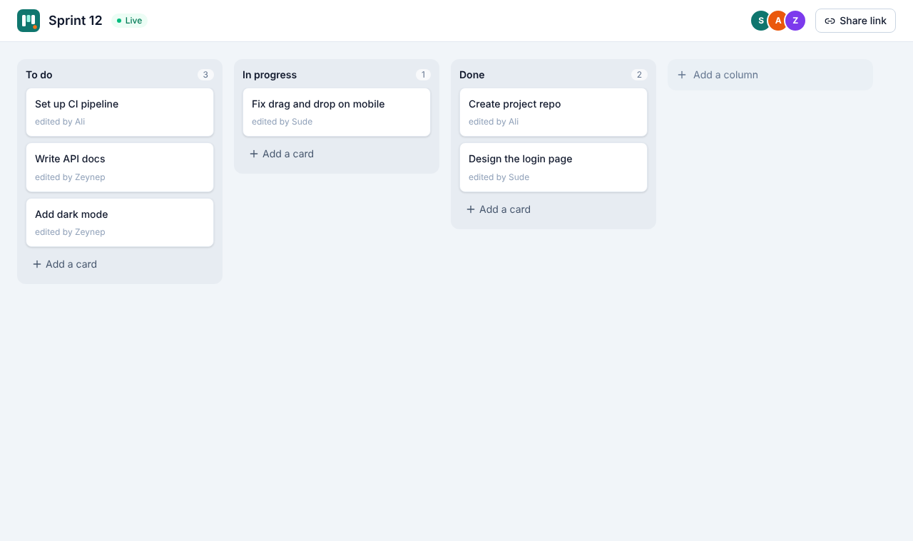
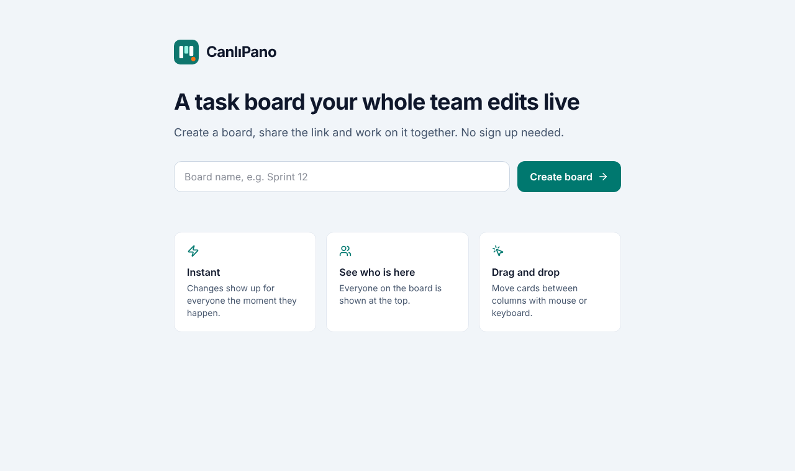
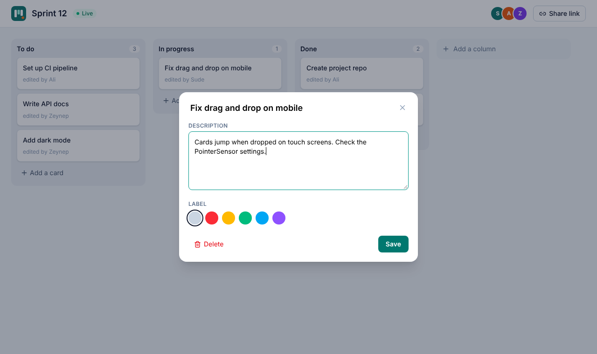

# CanlıPano

A real-time task board. Create a board, share the link, and everyone on it sees cards being added, edited and dragged between columns the moment it happens, along with who else is on the board.



## Features

- **Live collaboration** over WebSockets: cards, columns and edits sync to everyone instantly
- **Presence:** see who is on the board right now
- **Drag and drop** between and within columns, with mouse, touch or keyboard
- **Optimistic UI:** your changes appear immediately and are rolled back if the server rejects them
- **Reconnects** automatically and reloads the board, so nothing is missed after a network drop
- Card descriptions and colour labels, renameable columns, recent boards
- **No sign up:** a board's link is its key, like a shared document

| Home | Editing a card |
| --- | --- |
|  |  |

## Tech stack

| Part | Stack |
| --- | --- |
| Client | React 19, TypeScript, Vite, Tailwind CSS, dnd-kit, Socket.IO client |
| Server | Node.js, Express 5, Socket.IO, Prisma, PostgreSQL |
| Shared | TypeScript types, Zod schemas and the ordering algorithm used by both sides |
| Tooling | npm workspaces (monorepo), Vitest, GitHub Actions, Docker, Render blueprint |

## How it works

```
 Browser A ──┐                          ┌── Browser B
             │  card:move (+ ack)       │  card:upserted
             ▼                          │
        Socket.IO server ──► PostgreSQL ┘
        (validate, lock column, save, broadcast to room "board:<id>")
```

1. Every board is a Socket.IO **room**. Joining returns a full snapshot of the board.
2. A change is sent as an event with an **acknowledgement**. The server validates it with Zod, saves it, answers the sender and broadcasts the result to everyone else in the room.
3. The client applies its own change right away and replaces it with the server's version when the answer arrives. If the server says no, the previous state comes back and an error is shown.

### Ordering cards with fractional indexing

Each card has a string `position`. Moving a card gives it a new key that sorts between its new neighbours (`"a" < "an" < "b"`), so a move updates **one row** instead of renumbering every card below it. That keeps moves cheap and avoids conflicts when several people reorder the same column. See [`packages/shared/src/ordering.ts`](packages/shared/src/ordering.ts); a test performs 300 random moves and checks the order every time.

Appending to the end is the most common move, so it has its own path that increments the key instead of halving the gap. Without it, keys grew to 40 characters after 200 new cards; now they stay under 10.

### Concurrent moves

The client only says *where* a card should go ("before card X" or "at the end"); the server computes the key inside a transaction that locks the target column (`SELECT … FOR UPDATE`). Two people dropping cards into the same spot at the same moment are processed one after the other and never get the same position. A test fires six simultaneous moves into one column and checks all positions are unique.

### One protocol for both sides

`packages/shared` defines the event names, payload types and Zod schemas. The server validates incoming events with the schemas; the client is typed by the same definitions. A change to the protocol shows up as a type error on whichever side wasn't updated.

### Small but real details

- Changes are rate limited per connection with a token bucket (30 burst, 10/second)
- Boards from different links are isolated: card ids from another board are rejected
- Presence handles the same person in several tabs
- In production one Node process serves the API, WebSockets and the built React app

## Project structure

```
packages/shared/       # types, Socket.IO event map, Zod schemas, fractional indexing
apps/server/
  src/socket.ts        # event handlers, validation, rooms, presence
  src/boards.ts        # database logic (Prisma), column locking
  prisma/              # schema and migrations
  tests/               # integration tests with real sockets and PostgreSQL
apps/web/
  src/lib/useBoard.ts  # connection, optimistic updates, reconnect
  src/pages/           # home and board pages
  src/components/      # columns, cards, card dialog
```

## Running locally

```bash
docker compose up -d db             # PostgreSQL
cp apps/server/.env.example apps/server/.env
npm install
npm run db:migrate --workspace=@canlipano/server
npm run dev                         # http://localhost:5173
```

Open the board in two browser windows to see the live sync. Or run everything with `docker compose up --build` on http://localhost:4000.

## Tests

```bash
npm test
```

- **Shared:** ordering keys, including 300 random drag-and-drop moves
- **Server:** real Socket.IO clients against a real database: live sync between clients, presence, board isolation, reordering, concurrent moves, validation
- **Web:** the optimistic state updates

## Deploying

The repo includes a [Render](https://render.com) blueprint (`render.yaml`): create a new Blueprint from this repository and Render sets up the web service and a PostgreSQL database. Serverless hosts like Vercel can't keep WebSocket connections open, which is why this app runs as a regular Node service.
